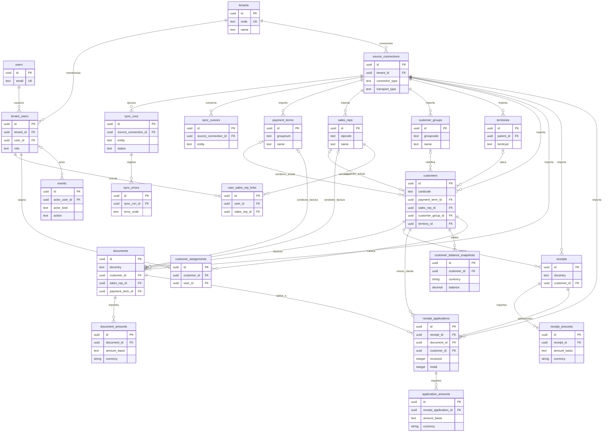
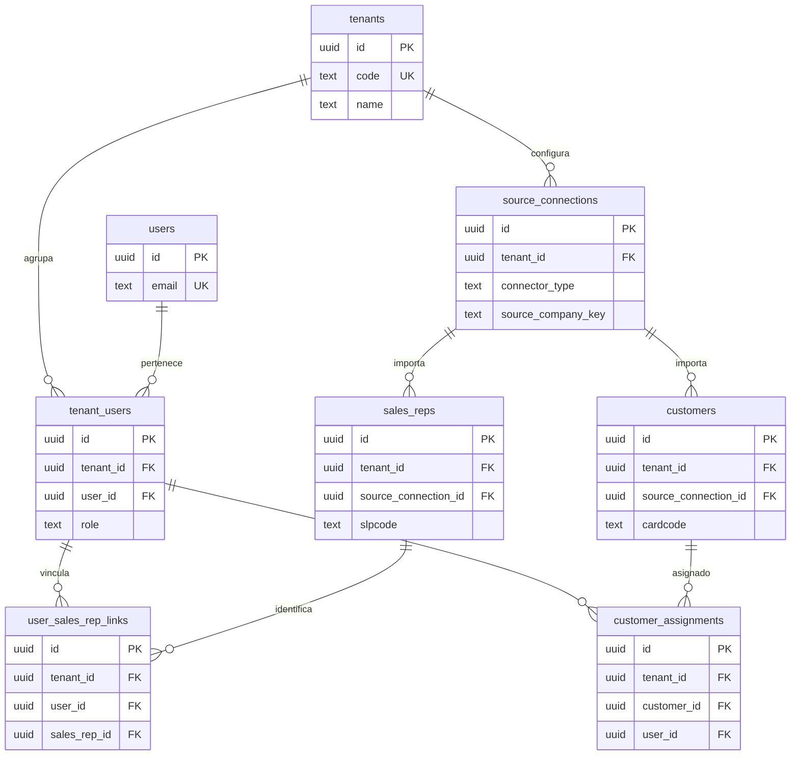
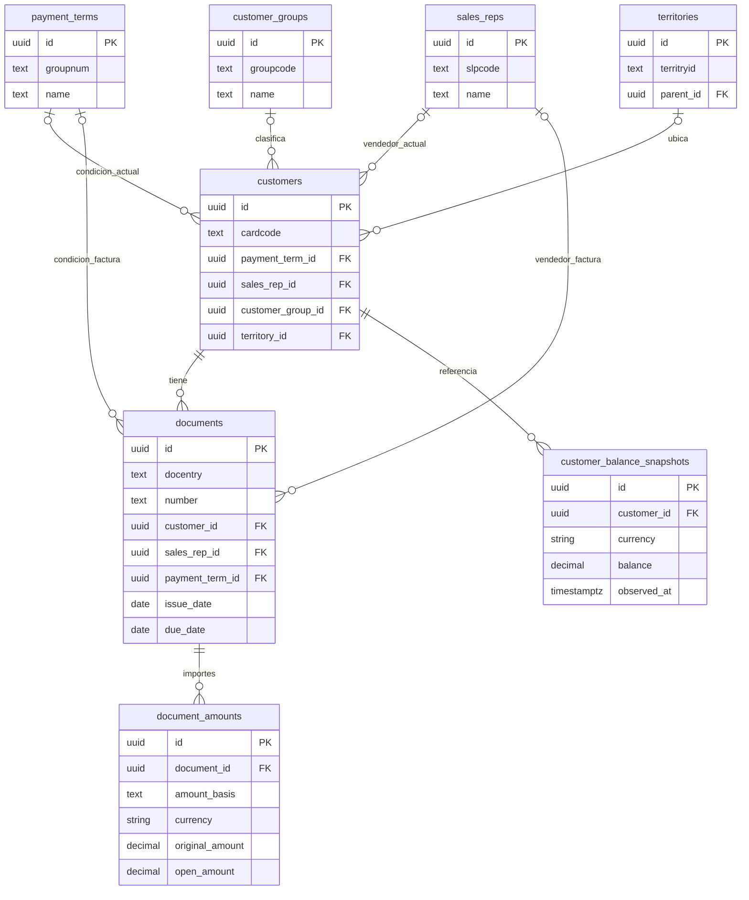
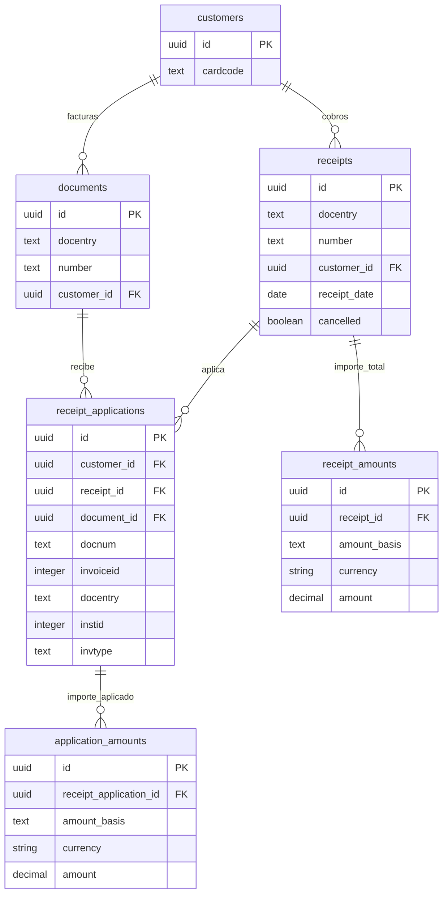
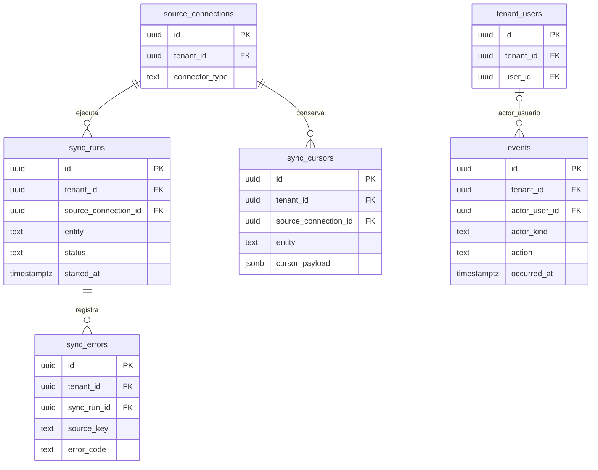

# dHermes — Esquema físico PostgreSQL y mapeo inicial SAP B1

Versión 0.5 · 19/10/2026 · Fuente: SAP Business One. Esquema PostgreSQL unificado: `dhermes`. Alcance documental: únicamente facturas.

## 1. Alcance concreto

Primera integración: lectura directa de SAP Business One mediante un conector autorizado a su base HANA/SQL Server o su API disponible. El archivo de staging se utilizó únicamente como referencia de columnas, no como fuente de integración. El transporte concreto se configura por conexión y debe validarse con la instalación. El núcleo usa nombres comunes de negocio. Otras empresas pueden usar sus propios servidores, motores o API mediante adaptadores que produzcan estas mismas entidades. No existe conexión automática a cualquier servidor: cada origen necesita mapeo y validación.

Se incluye consulta de cartera y cobros existentes. Registrar y enviar nuevos cobros al ERP queda fuera de esta versión.

**Qué cambió:** ahora cada campo tiene tipo, nulabilidad, valor predeterminado y origen. Se incluyen CREATE TABLE, FK compuestas, restricciones, índices y RLS. La validación del cuadre y el flujo de generación requieren código de aplicación; sus límites se especifican al final.

## 2. Decisiones de normalización

- Empresas, usuarios, vendedores, clientes y condiciones se guardan en tablas diferentes; los documentos usan FK, no copias de maestros.
- `dhermes.documents` contiene únicamente facturas; `document_type` queda restringido a INVOICE. La referencia externa única incluye empresa, conexión y tipo.
- Una fila de importes por entidad y base. Si ambas bases tienen la misma moneda, pueden coexistir pero nunca deben sumarse entre sí. Las consultas deben seleccionar una base explícita.
- No se crea un espejo de todo SAP: inventario, lotes, presupuestos y productos no son necesarios para esta primera versión de cobranzas.
- UUID internos con `gen_random_uuid()`; se conservan las claves originales con nombres explícitos: `cardcode`, `docentry`, `slpcode`, `groupnum`, `groupcode`, `territryid`. No se crea ni se inventa una segunda clave externa.

## 3. Tablas SAP B1 utilizadas

| Fuente actual | Destino | Identificador externo |
|---|---|---|
| `OCTG` | `dhermes.payment_terms` | `groupnum::text` |
| `OSLP` | `dhermes.sales_reps` | `slpcode::text` |
| `OCRG` | `dhermes.customer_groups` | `groupcode::text` |
| `OTER` | `dhermes.territories` | `territryid::text` |
| `OCRD` | `dhermes.customers` | `cardcode`; filtrar `cardtype = 'C'` y validar valores de instalación |
| `OINV` | `dhermes.documents` + `document_amounts` | `docentry::text`, tipo INVOICE |
| `ORCT` | `dhermes.receipts` + `receipt_amounts` | `docentry::text`; validar filtro de cobros de clientes |
| `RCT2` | `receipt_applications` + `application_amounts` | Columnas separadas `docnum`, `invoiceid`, `docentry`, `instid` |
| `OCRD.balance` | `customer_balance_snapshots` | ID interno por observación |

**Uniones de origen:** `OINV.CardCode = OCRD.CardCode`; `ORCT.CardCode = OCRD.CardCode`; `RCT2.DocNum = ORCT.DocEntry`; `RCT2.DocEntry = OINV.DocEntry` con `RCT2.InvType = '13'`. Seleccionar únicamente esas aplicaciones. Los otros tipos quedan fuera del alcance y no se convierten en facturas ni se consideran errores por sí mismos. Una aplicación a factura con referencia inexistente sí genera incidencia.

## 4. Diccionario físico de columnas — esquema único `dhermes`

En todas las tablas, `id` es PK UUID. “NULL: sí” significa opcional. Las restricciones y FK exactas aparecen en el SQL del apartado 5. Fechas del origen sin zona horaria se interpretan con `source_connections.source_timezone`. Los nombres de usuario y vendedor son entidades distintas.

### 4.1 dhermes.tenants
Empresa aislada; una razón social por tenant en esta versión.

| Columna | Tipo PostgreSQL | NULL | Default | Origen / significado |
|---|---|---|---|---|
| `id` | `UUID` | No | `gen_random_uuid()` | Identidad interna de dHermes |
| `code` | `TEXT` | No | — | Configuración; código público de empresa |
| `name` | `TEXT` | No | — | Configuración; nombre de empresa |
| `tax_id` | `TEXT` | Sí | — | Configuración; identificación fiscal |
| `timezone` | `TEXT` | No | — | Configuración IANA, por ejemplo America/La_Paz |
| `local_currency` | `CHAR(3)` | No | — | Moneda local validada con el ERP |
| `active` | `BOOLEAN` | No | `true` | Baja lógica |

### 4.2 dhermes.users
Identidad global de acceso; la pertenencia se define en memberships.

| Columna | Tipo PostgreSQL | NULL | Default | Origen / significado |
|---|---|---|---|---|
| `id` | `UUID` | No | `gen_random_uuid()` | Identidad interna de dHermes |
| `name` | `TEXT` | No | — | Registro de usuario |
| `email` | `TEXT` | No | — | Email de acceso normalizado a minúsculas |
| `password_hash` | `TEXT` | Sí | — | Hash del proveedor de autenticación; nulo si identidad externa |
| `auth_subject` | `TEXT` | Sí | — | Identificador externo de autenticación, si corresponde |
| `active` | `BOOLEAN` | No | `true` | Baja lógica |

### 4.3 dhermes.tenant_users
Membresía de usuario y rol por empresa.

| Columna | Tipo PostgreSQL | NULL | Default | Origen / significado |
|---|---|---|---|---|
| `id` | `UUID` | No | `gen_random_uuid()` | Identidad interna de dHermes |
| `tenant_id` | `UUID` | No | — | Empresa propietaria; contexto autenticado |
| `user_id` | `UUID` | No | — | dhermes.users.id |
| `role` | `TEXT` | No | — | admin, supervisor, seller o collector |
| `active` | `BOOLEAN` | No | `true` | Estado de la membresía |

### 4.4 dhermes.source_connections
Instalación concreta del ERP; motor y producto son conceptos separados.

| Columna | Tipo PostgreSQL | NULL | Default | Origen / significado |
|---|---|---|---|---|
| `id` | `UUID` | No | `gen_random_uuid()` | Identidad interna de dHermes |
| `tenant_id` | `UUID` | No | — | Empresa propietaria; contexto autenticado |
| `name` | `TEXT` | No | — | Nombre de la conexión |
| `connector_type` | `TEXT` | No | — | Primero SAP_B1; otros conectores posteriormente |
| `transport_type` | `TEXT` | No | — | HANA_SQL, SQLSERVER_SQL, API o AGENT; otros transportes según conector |
| `source_company_key` | `TEXT` | No | — | Identificador de sociedad/base de origen |
| `endpoint` | `TEXT` | Sí | — | Servidor o URL, sin contraseña |
| `secret_reference` | `TEXT` | Sí | — | Referencia a secreto cifrado administrado fuera de las tablas |
| `source_timezone` | `TEXT` | No | — | Zona horaria para interpretar marcas del origen |
| `mapping_version` | `TEXT` | No | — | Versión del adaptador/mapeo |
| `settings` | `JSONB` | No | `'{}'::jsonb` | Configuración no secreta, no datos de negocio |
| `active` | `BOOLEAN` | No | `true` | Conexión activa |

### 4.5 dhermes.sync_runs
Lote de importación por conexión y entidad.

| Columna | Tipo PostgreSQL | NULL | Default | Origen / significado |
|---|---|---|---|---|
| `id` | `UUID` | No | `gen_random_uuid()` | Identidad interna de dHermes |
| `tenant_id` | `UUID` | No | — | Empresa propietaria; contexto autenticado |
| `source_connection_id` | `UUID` | No | — | Conexión utilizada |
| `entity` | `TEXT` | No | — | customers, documents, receipts, etc. |
| `status` | `TEXT` | No | `'RUNNING'` | Estado del lote |
| `started_at` | `TIMESTAMPTZ` | No | `now()` | Inicio |
| `finished_at` | `TIMESTAMPTZ` | Sí | — | Fin |
| `source_as_of` | `TIMESTAMPTZ` | Sí | — | Corte declarado por la fuente |
| `records_read` | `BIGINT` | No | `0` | Filas leídas |
| `records_written` | `BIGINT` | No | `0` | Filas escritas |
| `records_rejected` | `BIGINT` | No | `0` | Filas rechazadas |

### 4.6 dhermes.sync_cursors
Cursor de lectura propio por conexión SAP B1 y entidad.

| Columna | Tipo PostgreSQL | NULL | Default | Origen / significado |
|---|---|---|---|---|
| `id` | `UUID` | No | `gen_random_uuid()` | Identidad interna de dHermes |
| `tenant_id` | `UUID` | No | — | Empresa propietaria; contexto autenticado |
| `source_connection_id` | `UUID` | No | — | Conexión |
| `entity` | `TEXT` | No | — | Entidad importada |
| `cursor_payload` | `JSONB` | No | `'{}'::jsonb` | Token o fecha y clave de desempate |
| `last_success_at` | `TIMESTAMPTZ` | Sí | — | Último avance exitoso |

### 4.7 dhermes.sync_errors
Registro de filas no importadas o inconsistencias.

| Columna | Tipo PostgreSQL | NULL | Default | Origen / significado |
|---|---|---|---|---|
| `id` | `UUID` | No | `gen_random_uuid()` | Identidad interna de dHermes |
| `tenant_id` | `UUID` | No | — | Empresa propietaria; contexto autenticado |
| `sync_run_id` | `UUID` | No | — | Ejecución |
| `source_key` | `TEXT` | Sí | — | Identificador del registro afectado |
| `error_code` | `TEXT` | No | — | Código estable |
| `message` | `TEXT` | No | — | Descripción sin credenciales |

### 4.8 dhermes.payment_terms
Condiciones de pago; OCTG.

| Columna | Tipo PostgreSQL | NULL | Default | Origen / significado |
|---|---|---|---|---|
| `id` | `UUID` | No | `gen_random_uuid()` | Identidad interna de dHermes |
| `tenant_id` | `UUID` | No | — | Empresa propietaria; contexto autenticado |
| `source_connection_id` | `UUID` | No | — | Conexión que identifica el origen |
| `groupnum` | `TEXT` | No | — | OCTG.GroupNum |
| `name` | `TEXT` | No | — | octg.pymntgroup |
| `source_updated_at` | `TIMESTAMPTZ` | Sí | — | updatedate de origen; zona horaria del origen, no inventar hora |
| `synced_at` | `TIMESTAMPTZ` | No | `now()` | Última importación en dHermes |
| `sync_run_id` | `UUID` | No | — | Ejecución de importación |

### 4.9 dhermes.sales_reps
Vendedores del ERP; no son automáticamente usuarios.

| Columna | Tipo PostgreSQL | NULL | Default | Origen / significado |
|---|---|---|---|---|
| `id` | `UUID` | No | `gen_random_uuid()` | Identidad interna de dHermes |
| `tenant_id` | `UUID` | No | — | Empresa propietaria; contexto autenticado |
| `source_connection_id` | `UUID` | No | — | Conexión que identifica el origen |
| `slpcode` | `TEXT` | No | — | OSLP.SlpCode |
| `name` | `TEXT` | No | — | oslp.slpname |
| `email` | `TEXT` | Sí | — | oslp.email |
| `active` | `BOOLEAN` | Sí | — | oslp.active; normalizar bandera |
| `source_updated_at` | `TIMESTAMPTZ` | Sí | — | updatedate de origen; zona horaria del origen, no inventar hora |
| `synced_at` | `TIMESTAMPTZ` | No | `now()` | Última importación en dHermes |
| `sync_run_id` | `UUID` | No | — | Ejecución de importación |

### 4.10 dhermes.customer_groups
Grupos de clientes; OCRG.

| Columna | Tipo PostgreSQL | NULL | Default | Origen / significado |
|---|---|---|---|---|
| `id` | `UUID` | No | `gen_random_uuid()` | Identidad interna de dHermes |
| `tenant_id` | `UUID` | No | — | Empresa propietaria; contexto autenticado |
| `source_connection_id` | `UUID` | No | — | Conexión que identifica el origen |
| `groupcode` | `TEXT` | No | — | OCRG.GroupCode |
| `name` | `TEXT` | No | — | ocrg.groupname |
| `source_updated_at` | `TIMESTAMPTZ` | Sí | — | updatedate de origen; zona horaria del origen, no inventar hora |
| `synced_at` | `TIMESTAMPTZ` | No | `now()` | Última importación en dHermes |
| `sync_run_id` | `UUID` | No | — | Ejecución de importación |

### 4.11 dhermes.territories
Territorios; OTER.

| Columna | Tipo PostgreSQL | NULL | Default | Origen / significado |
|---|---|---|---|---|
| `id` | `UUID` | No | `gen_random_uuid()` | Identidad interna de dHermes |
| `tenant_id` | `UUID` | No | — | Empresa propietaria; contexto autenticado |
| `source_connection_id` | `UUID` | No | — | Conexión que identifica el origen |
| `territryid` | `TEXT` | No | — | OTER.TerritryID |
| `name` | `TEXT` | No | — | oter.descript |
| `parent_id` | `UUID` | Sí | — | Resolver oter.parent a territorio de la misma conexión |
| `source_updated_at` | `TIMESTAMPTZ` | Sí | — | updatedate de origen; zona horaria del origen, no inventar hora |
| `synced_at` | `TIMESTAMPTZ` | No | `now()` | Última importación en dHermes |
| `sync_run_id` | `UUID` | No | — | Ejecución de importación |

### 4.12 dhermes.customers
Clientes importados de OCRD; seleccionar cardtype de cliente.

| Columna | Tipo PostgreSQL | NULL | Default | Origen / significado |
|---|---|---|---|---|
| `id` | `UUID` | No | `gen_random_uuid()` | Identidad interna de dHermes |
| `tenant_id` | `UUID` | No | — | Empresa propietaria; contexto autenticado |
| `source_connection_id` | `UUID` | No | — | Conexión que identifica el origen |
| `cardcode` | `TEXT` | No | — | OCRD.CardCode |
| `name` | `TEXT` | No | — | ocrd.cardname |
| `tax_id` | `TEXT` | Sí | — | No incluido en referencia de columnas; verificar y mapear desde SAP B1 |
| `phone` | `TEXT` | Sí | — | ocrd.phone1 |
| `email` | `TEXT` | Sí | — | ocrd.e_mail |
| `address` | `TEXT` | Sí | — | ocrd.address |
| `currency_preference` | `TEXT` | Sí | — | ocrd.currency; admite marcador multimoneda del origen |
| `credit_limit_local` | `NUMERIC(19,6)` | Sí | — | ocrd.creditline, tras verificar moneda local |
| `payment_term_id` | `UUID` | Sí | — | Resolver ocrd.groupnum |
| `sales_rep_id` | `UUID` | Sí | — | Resolver ocrd.slpcode |
| `customer_group_id` | `UUID` | Sí | — | Resolver ocrd.groupcode |
| `territory_id` | `UUID` | Sí | — | Resolver ocrd.territory |
| `active` | `BOOLEAN` | Sí | — | No hay bandera explícita en el DDL entregado |
| `source_updated_at` | `TIMESTAMPTZ` | Sí | — | updatedate de origen; zona horaria del origen, no inventar hora |
| `synced_at` | `TIMESTAMPTZ` | No | `now()` | Última importación en dHermes |
| `sync_run_id` | `UUID` | No | — | Ejecución de importación |

### 4.13 dhermes.documents
Factura de venta; entidad normalizada independiente del ERP.

| Columna | Tipo PostgreSQL | NULL | Default | Origen / significado |
|---|---|---|---|---|
| `id` | `UUID` | No | `gen_random_uuid()` | Identidad interna de dHermes |
| `tenant_id` | `UUID` | No | — | Empresa propietaria; contexto autenticado |
| `source_connection_id` | `UUID` | No | — | Conexión que identifica el origen |
| `docentry` | `TEXT` | No | — | OINV.DocEntry |
| `document_type` | `TEXT` | No | — | INVOICE desde OINV; único tipo permitido |
| `number` | `TEXT` | No | — | docnum convertido a texto |
| `series` | `TEXT` | Sí | — | series convertido a texto |
| `customer_reference` | `TEXT` | Sí | — | numatcard; no asumir número fiscal |
| `customer_id` | `UUID` | No | — | Resolver cardcode |
| `sales_rep_id` | `UUID` | Sí | — | Resolver slpcode de documento |
| `payment_term_id` | `UUID` | Sí | — | Resolver groupnum de documento |
| `issue_date` | `DATE` | No | — | docdate |
| `due_date` | `DATE` | Sí | — | docduedate |
| `source_status` | `TEXT` | Sí | — | docstatus sin perder valor original |
| `status` | `TEXT` | No | `'UNKNOWN'` | OPEN, CLOSED o UNKNOWN |
| `cancelled` | `BOOLEAN` | No | — | canceled interpretado por el conector |
| `source_updated_at` | `TIMESTAMPTZ` | Sí | — | updatedate de origen; zona horaria del origen, no inventar hora |
| `synced_at` | `TIMESTAMPTZ` | No | `now()` | Última importación en dHermes |
| `sync_run_id` | `UUID` | No | — | Ejecución de importación |

### 4.14 dhermes.document_amounts
Importes separados de cabecera: una fila por base monetaria, sin columnas FC específicas del ERP.

| Columna | Tipo PostgreSQL | NULL | Default | Origen / significado |
|---|---|---|---|---|
| `id` | `UUID` | No | `gen_random_uuid()` | Identidad interna de dHermes |
| `tenant_id` | `UUID` | No | — | Empresa propietaria; contexto autenticado |
| `document_id` | `UUID` | No | — | Documento |
| `amount_basis` | `TEXT` | No | — | DOCUMENT o LOCAL |
| `currency` | `CHAR(3)` | No | — | Moneda efectiva de estos importes |
| `original_amount` | `NUMERIC(19,6)` | No | — | LOCAL: doctotal; DOCUMENT: solo con importe documentado |
| `settled_amount` | `NUMERIC(19,6)` | Sí | — | LOCAL: paidtodate validado; no equivale solo a efectivo |
| `open_amount` | `NUMERIC(19,6)` | Sí | — | Saldo conciliado con el origen |
| `observed_at` | `TIMESTAMPTZ` | No | — | Fecha de observación de importes |

### 4.15 dhermes.receipts
Cobros ya registrados en ERP; ORCT.

| Columna | Tipo PostgreSQL | NULL | Default | Origen / significado |
|---|---|---|---|---|
| `id` | `UUID` | No | `gen_random_uuid()` | Identidad interna de dHermes |
| `tenant_id` | `UUID` | No | — | Empresa propietaria; contexto autenticado |
| `source_connection_id` | `UUID` | No | — | Conexión que identifica el origen |
| `docentry` | `TEXT` | No | — | ORCT.DocEntry |
| `customer_id` | `UUID` | No | — | Resolver orct.cardcode; seleccionar cobros de clientes |
| `number` | `TEXT` | No | — | orct.docnum |
| `receipt_date` | `DATE` | No | — | orct.docdate |
| `cancelled` | `BOOLEAN` | No | — | orct.canceled |
| `source_currency` | `TEXT` | Sí | — | orct.doccurr; referencia original |
| `source_updated_at` | `TIMESTAMPTZ` | Sí | — | updatedate de origen; zona horaria del origen, no inventar hora |
| `synced_at` | `TIMESTAMPTZ` | No | `now()` | Última importación en dHermes |
| `sync_run_id` | `UUID` | No | — | Ejecución de importación |

### 4.16 dhermes.receipt_amounts
Importe del cobro por base monetaria.

| Columna | Tipo PostgreSQL | NULL | Default | Origen / significado |
|---|---|---|---|---|
| `id` | `UUID` | No | `gen_random_uuid()` | Identidad interna de dHermes |
| `tenant_id` | `UUID` | No | — | Empresa propietaria; contexto autenticado |
| `receipt_id` | `UUID` | No | — | Cobro |
| `amount_basis` | `TEXT` | No | — | DOCUMENT o LOCAL |
| `currency` | `CHAR(3)` | No | — | Moneda real del importe |
| `amount` | `NUMERIC(19,6)` | No | — | orct.doctotal solo con base monetaria validada |

### 4.17 dhermes.receipt_applications
Aplicación importada; separar relación documental de importes.

| Columna | Tipo PostgreSQL | NULL | Default | Origen / significado |
|---|---|---|---|---|
| `id` | `UUID` | No | `gen_random_uuid()` | Identidad interna de dHermes |
| `tenant_id` | `UUID` | No | — | Empresa propietaria; contexto autenticado |
| `source_connection_id` | `UUID` | No | — | Conexión |
| `docnum` | `TEXT` | No | — | RCT2.DocNum: referencia a ORCT.DocEntry, no al número visible de cobro. |
| `invoiceid` | `INTEGER` | No | — | RCT2.InvoiceId: secuencia de la aplicación dentro del cobro. |
| `docentry` | `TEXT` | No | — | RCT2.DocEntry: referencia a OINV.DocEntry. |
| `instid` | `INTEGER` | No | — | RCT2.InstId: referencia de origen; no implica cuotas programadas. |
| `invtype` | `TEXT` | No | '13' | Únicamente aplicaciones a factura. |
| `customer_id` | `UUID` | No | — | Cliente común del cobro y documento |
| `receipt_id` | `UUID` | No | — | rct2.docnum resuelve orct.docentry |
| `document_id` | `UUID` | No | — | rct2.invtype y docentry resuelven documento |
| `application_date` | `DATE` | Sí | — | No incluida en referencia; verificar en SAP B1, sin sustituir por fecha de cobro |
| `sync_run_id` | `UUID` | No | — | Lote de importación |
| `synced_at` | `TIMESTAMPTZ` | No | `now()` | Última importación |

### 4.18 dhermes.application_amounts
Importe aplicado por base monetaria.

| Columna | Tipo PostgreSQL | NULL | Default | Origen / significado |
|---|---|---|---|---|
| `id` | `UUID` | No | `gen_random_uuid()` | Identidad interna de dHermes |
| `tenant_id` | `UUID` | No | — | Empresa propietaria; contexto autenticado |
| `receipt_application_id` | `UUID` | No | — | Aplicación |
| `amount_basis` | `TEXT` | No | — | DOCUMENT o LOCAL; DOCUMENT refiere a moneda de factura destino |
| `currency` | `CHAR(3)` | No | — | Moneda efectiva |
| `amount` | `NUMERIC(19,6)` | No | — | rct2.sumapplied para base local verificada; FC no disponible actualmente |

### 4.19 dhermes.customer_balance_snapshots
Saldo de referencia de cliente, no reemplaza el saldo por documento.

| Columna | Tipo PostgreSQL | NULL | Default | Origen / significado |
|---|---|---|---|---|
| `id` | `UUID` | No | `gen_random_uuid()` | Identidad interna de dHermes |
| `tenant_id` | `UUID` | No | — | Empresa propietaria; contexto autenticado |
| `customer_id` | `UUID` | No | — | Cliente |
| `currency` | `CHAR(3)` | No | — | Moneda del saldo validada; no tomar preferencia del cliente |
| `balance` | `NUMERIC(19,6)` | No | — | ocrd.balance |
| `observed_at` | `TIMESTAMPTZ` | No | — | Fecha del dato |
| `scope` | `TEXT` | No | — | Descripción del alcance del saldo |
| `sync_run_id` | `UUID` | No | — | Ejecución |

### 4.20 dhermes.user_sales_rep_links
Vincula identidad de acceso y vendedor de origen.

| Columna | Tipo PostgreSQL | NULL | Default | Origen / significado |
|---|---|---|---|---|
| `id` | `UUID` | No | `gen_random_uuid()` | Identidad interna de dHermes |
| `tenant_id` | `UUID` | No | — | Empresa propietaria; contexto autenticado |
| `user_id` | `UUID` | No | — | Usuario miembro de empresa |
| `sales_rep_id` | `UUID` | No | — | Vendedor de empresa |
| `valid_from` | `TIMESTAMPTZ` | No | `now()` | Inicio |
| `valid_to` | `TIMESTAMPTZ` | Sí | — | Fin de vigencia |

### 4.21 dhermes.customer_assignments
Cartera asignada al usuario cobrador.

| Columna | Tipo PostgreSQL | NULL | Default | Origen / significado |
|---|---|---|---|---|
| `id` | `UUID` | No | `gen_random_uuid()` | Identidad interna de dHermes |
| `tenant_id` | `UUID` | No | — | Empresa propietaria; contexto autenticado |
| `customer_id` | `UUID` | No | — | Cliente |
| `user_id` | `UUID` | No | — | Usuario miembro de empresa |
| `valid_from` | `TIMESTAMPTZ` | No | `now()` | Inicio |
| `valid_to` | `TIMESTAMPTZ` | Sí | — | Fin |

### 4.22 dhermes.events
Auditoría general solo anexable.

| Columna | Tipo PostgreSQL | NULL | Default | Origen / significado |
|---|---|---|---|---|
| `id` | `UUID` | No | `gen_random_uuid()` | Identidad interna de dHermes |
| `tenant_id` | `UUID` | No | — | Empresa propietaria; contexto autenticado |
| `actor_user_id` | `UUID` | Sí | — | Miembro de empresa o evento de sistema |
| `actor_kind` | `TEXT` | No | — | USER o SYSTEM |
| `action` | `TEXT` | No | — | Acción |
| `entity` | `TEXT` | No | — | Entidad |
| `entity_id` | `TEXT` | Sí | — | Identificador |
| `occurred_at` | `TIMESTAMPTZ` | No | `now()` | Fecha |
| `details` | `JSONB` | No | `'{}'::jsonb` | Contexto sin secretos |

## 5. DDL físico propuesto — esquema único `dhermes`

Ejecutar únicamente en una base vacía preparada para dHermes. No usar como migración sobre tablas existentes. El DDL está diseñado como una transacción y falla si los esquemas ya existen: no oculta incompatibilidades mediante IF NOT EXISTS. No crea roles, usuarios ni credenciales. Las FK se agregan al final para resolver dependencias.

```sql
BEGIN;

CREATE SCHEMA dhermes;

CREATE TABLE dhermes.tenants (
  id UUID PRIMARY KEY DEFAULT gen_random_uuid(),
  code TEXT NOT NULL,
  name TEXT NOT NULL,
  tax_id TEXT,
  timezone TEXT NOT NULL,
  local_currency CHAR(3) NOT NULL,
  active BOOLEAN NOT NULL DEFAULT true,
  created_at TIMESTAMPTZ NOT NULL DEFAULT now(),
  UNIQUE (code)
);

CREATE TABLE dhermes.users (
  id UUID PRIMARY KEY DEFAULT gen_random_uuid(),
  name TEXT NOT NULL,
  email TEXT NOT NULL,
  password_hash TEXT,
  auth_subject TEXT,
  active BOOLEAN NOT NULL DEFAULT true,
  created_at TIMESTAMPTZ NOT NULL DEFAULT now(),
  UNIQUE (email),
  UNIQUE (auth_subject),
  CHECK (password_hash IS NOT NULL OR auth_subject IS NOT NULL)
);

CREATE TABLE dhermes.tenant_users (
  id UUID PRIMARY KEY DEFAULT gen_random_uuid(),
  tenant_id UUID NOT NULL,
  user_id UUID NOT NULL,
  role TEXT NOT NULL,
  active BOOLEAN NOT NULL DEFAULT true,
  created_at TIMESTAMPTZ NOT NULL DEFAULT now(),
  UNIQUE (tenant_id, id),
  UNIQUE (tenant_id, user_id),
  CHECK (role IN ('admin', 'supervisor', 'seller', 'collector'))
);

CREATE TABLE dhermes.source_connections (
  id UUID PRIMARY KEY DEFAULT gen_random_uuid(),
  tenant_id UUID NOT NULL,
  name TEXT NOT NULL,
  connector_type TEXT NOT NULL,
  transport_type TEXT NOT NULL,
  source_company_key TEXT NOT NULL,
  endpoint TEXT,
  secret_reference TEXT,
  source_timezone TEXT NOT NULL,
  mapping_version TEXT NOT NULL,
  settings JSONB NOT NULL DEFAULT '{}'::jsonb,
  active BOOLEAN NOT NULL DEFAULT true,
  created_at TIMESTAMPTZ NOT NULL DEFAULT now(),
  UNIQUE (tenant_id, id)
);

CREATE TABLE dhermes.sync_runs (
  id UUID PRIMARY KEY DEFAULT gen_random_uuid(),
  tenant_id UUID NOT NULL,
  source_connection_id UUID NOT NULL,
  entity TEXT NOT NULL,
  status TEXT NOT NULL DEFAULT 'RUNNING',
  started_at TIMESTAMPTZ NOT NULL DEFAULT now(),
  finished_at TIMESTAMPTZ,
  source_as_of TIMESTAMPTZ,
  records_read BIGINT NOT NULL DEFAULT 0,
  records_written BIGINT NOT NULL DEFAULT 0,
  records_rejected BIGINT NOT NULL DEFAULT 0,
  created_at TIMESTAMPTZ NOT NULL DEFAULT now(),
  UNIQUE (tenant_id, id),
  UNIQUE (tenant_id, source_connection_id, id),
  CHECK (status IN ('RUNNING', 'OK', 'ERROR')),
  CHECK (records_read >= 0 AND records_written >= 0 AND records_rejected >= 0),
  CHECK (finished_at IS NULL OR finished_at >= started_at)
);

CREATE TABLE dhermes.sync_cursors (
  id UUID PRIMARY KEY DEFAULT gen_random_uuid(),
  tenant_id UUID NOT NULL,
  source_connection_id UUID NOT NULL,
  entity TEXT NOT NULL,
  cursor_payload JSONB NOT NULL DEFAULT '{}'::jsonb,
  last_success_at TIMESTAMPTZ,
  created_at TIMESTAMPTZ NOT NULL DEFAULT now(),
  UNIQUE (tenant_id, id),
  UNIQUE (tenant_id, source_connection_id, entity)
);

CREATE TABLE dhermes.sync_errors (
  id UUID PRIMARY KEY DEFAULT gen_random_uuid(),
  tenant_id UUID NOT NULL,
  sync_run_id UUID NOT NULL,
  source_key TEXT,
  error_code TEXT NOT NULL,
  message TEXT NOT NULL,
  created_at TIMESTAMPTZ NOT NULL DEFAULT now(),
  UNIQUE (tenant_id, id)
);

CREATE TABLE dhermes.payment_terms (
  id UUID PRIMARY KEY DEFAULT gen_random_uuid(),
  tenant_id UUID NOT NULL,
  source_connection_id UUID NOT NULL,
  groupnum TEXT NOT NULL,
  name TEXT NOT NULL,
  created_at TIMESTAMPTZ NOT NULL DEFAULT now(),
  source_updated_at TIMESTAMPTZ,
  synced_at TIMESTAMPTZ NOT NULL DEFAULT now(),
  sync_run_id UUID NOT NULL,
  UNIQUE (tenant_id, id),
  UNIQUE (tenant_id, source_connection_id, id),
  UNIQUE (tenant_id, source_connection_id, groupnum)
);

CREATE TABLE dhermes.sales_reps (
  id UUID PRIMARY KEY DEFAULT gen_random_uuid(),
  tenant_id UUID NOT NULL,
  source_connection_id UUID NOT NULL,
  slpcode TEXT NOT NULL,
  name TEXT NOT NULL,
  email TEXT,
  active BOOLEAN,
  created_at TIMESTAMPTZ NOT NULL DEFAULT now(),
  source_updated_at TIMESTAMPTZ,
  synced_at TIMESTAMPTZ NOT NULL DEFAULT now(),
  sync_run_id UUID NOT NULL,
  UNIQUE (tenant_id, id),
  UNIQUE (tenant_id, source_connection_id, id),
  UNIQUE (tenant_id, source_connection_id, slpcode)
);

CREATE TABLE dhermes.customer_groups (
  id UUID PRIMARY KEY DEFAULT gen_random_uuid(),
  tenant_id UUID NOT NULL,
  source_connection_id UUID NOT NULL,
  groupcode TEXT NOT NULL,
  name TEXT NOT NULL,
  created_at TIMESTAMPTZ NOT NULL DEFAULT now(),
  source_updated_at TIMESTAMPTZ,
  synced_at TIMESTAMPTZ NOT NULL DEFAULT now(),
  sync_run_id UUID NOT NULL,
  UNIQUE (tenant_id, id),
  UNIQUE (tenant_id, source_connection_id, id),
  UNIQUE (tenant_id, source_connection_id, groupcode)
);

CREATE TABLE dhermes.territories (
  id UUID PRIMARY KEY DEFAULT gen_random_uuid(),
  tenant_id UUID NOT NULL,
  source_connection_id UUID NOT NULL,
  territryid TEXT NOT NULL,
  name TEXT NOT NULL,
  parent_id UUID,
  created_at TIMESTAMPTZ NOT NULL DEFAULT now(),
  source_updated_at TIMESTAMPTZ,
  synced_at TIMESTAMPTZ NOT NULL DEFAULT now(),
  sync_run_id UUID NOT NULL,
  UNIQUE (tenant_id, id),
  UNIQUE (tenant_id, source_connection_id, id),
  UNIQUE (tenant_id, source_connection_id, territryid),
  CHECK (parent_id IS NULL OR parent_id <> id)
);

CREATE TABLE dhermes.customers (
  id UUID PRIMARY KEY DEFAULT gen_random_uuid(),
  tenant_id UUID NOT NULL,
  source_connection_id UUID NOT NULL,
  cardcode TEXT NOT NULL,
  name TEXT NOT NULL,
  tax_id TEXT,
  phone TEXT,
  email TEXT,
  address TEXT,
  currency_preference TEXT,
  credit_limit_local NUMERIC(19,6),
  payment_term_id UUID,
  sales_rep_id UUID,
  customer_group_id UUID,
  territory_id UUID,
  active BOOLEAN,
  created_at TIMESTAMPTZ NOT NULL DEFAULT now(),
  source_updated_at TIMESTAMPTZ,
  synced_at TIMESTAMPTZ NOT NULL DEFAULT now(),
  sync_run_id UUID NOT NULL,
  UNIQUE (tenant_id, id),
  UNIQUE (tenant_id, source_connection_id, id),
  UNIQUE (tenant_id, source_connection_id, cardcode)
);

CREATE TABLE dhermes.documents (
  id UUID PRIMARY KEY DEFAULT gen_random_uuid(),
  tenant_id UUID NOT NULL,
  source_connection_id UUID NOT NULL,
  docentry TEXT NOT NULL,
  document_type TEXT NOT NULL,
  number TEXT NOT NULL,
  series TEXT,
  customer_reference TEXT,
  customer_id UUID NOT NULL,
  sales_rep_id UUID,
  payment_term_id UUID,
  issue_date DATE NOT NULL,
  due_date DATE,
  source_status TEXT,
  status TEXT NOT NULL DEFAULT 'UNKNOWN',
  cancelled BOOLEAN NOT NULL,
  created_at TIMESTAMPTZ NOT NULL DEFAULT now(),
  source_updated_at TIMESTAMPTZ,
  synced_at TIMESTAMPTZ NOT NULL DEFAULT now(),
  sync_run_id UUID NOT NULL,
  UNIQUE (tenant_id, id),
  UNIQUE (tenant_id, source_connection_id, id),
  UNIQUE (tenant_id, source_connection_id, document_type, docentry),
  CHECK (document_type = 'INVOICE'),
  CHECK (status IN ('OPEN', 'CLOSED', 'UNKNOWN')),
  UNIQUE (tenant_id, source_connection_id, customer_id, id),
  UNIQUE (tenant_id, source_connection_id, id, docentry)
);

CREATE TABLE dhermes.document_amounts (
  id UUID PRIMARY KEY DEFAULT gen_random_uuid(),
  tenant_id UUID NOT NULL,
  document_id UUID NOT NULL,
  amount_basis TEXT NOT NULL,
  currency CHAR(3) NOT NULL,
  original_amount NUMERIC(19,6) NOT NULL,
  settled_amount NUMERIC(19,6),
  open_amount NUMERIC(19,6),
  observed_at TIMESTAMPTZ NOT NULL,
  created_at TIMESTAMPTZ NOT NULL DEFAULT now(),
  UNIQUE (tenant_id, id),
  UNIQUE (tenant_id, document_id, amount_basis),
  CHECK (amount_basis IN ('DOCUMENT', 'LOCAL'))
);


CREATE TABLE dhermes.receipts (
  id UUID PRIMARY KEY DEFAULT gen_random_uuid(),
  tenant_id UUID NOT NULL,
  source_connection_id UUID NOT NULL,
  docentry TEXT NOT NULL,
  customer_id UUID NOT NULL,
  number TEXT NOT NULL,
  receipt_date DATE NOT NULL,
  cancelled BOOLEAN NOT NULL,
  source_currency TEXT,
  created_at TIMESTAMPTZ NOT NULL DEFAULT now(),
  source_updated_at TIMESTAMPTZ,
  synced_at TIMESTAMPTZ NOT NULL DEFAULT now(),
  sync_run_id UUID NOT NULL,
  UNIQUE (tenant_id, id),
  UNIQUE (tenant_id, source_connection_id, id),
  UNIQUE (tenant_id, source_connection_id, docentry),
  UNIQUE (tenant_id, source_connection_id, customer_id, id),
  UNIQUE (tenant_id, source_connection_id, id, docentry)
);

CREATE TABLE dhermes.receipt_amounts (
  id UUID PRIMARY KEY DEFAULT gen_random_uuid(),
  tenant_id UUID NOT NULL,
  receipt_id UUID NOT NULL,
  amount_basis TEXT NOT NULL,
  currency CHAR(3) NOT NULL,
  amount NUMERIC(19,6) NOT NULL,
  created_at TIMESTAMPTZ NOT NULL DEFAULT now(),
  UNIQUE (tenant_id, id),
  UNIQUE (tenant_id, receipt_id, amount_basis),
  CHECK (amount_basis IN ('DOCUMENT', 'LOCAL'))
);

CREATE TABLE dhermes.receipt_applications (
  id UUID PRIMARY KEY DEFAULT gen_random_uuid(),
  tenant_id UUID NOT NULL,
  source_connection_id UUID NOT NULL,
  docnum TEXT NOT NULL,
  invoiceid INTEGER NOT NULL,
  docentry TEXT NOT NULL,
  instid INTEGER NOT NULL,
  invtype TEXT NOT NULL DEFAULT '13',
  customer_id UUID NOT NULL,
  receipt_id UUID NOT NULL,
  document_id UUID NOT NULL,
  application_date DATE,
  sync_run_id UUID NOT NULL,
  synced_at TIMESTAMPTZ NOT NULL DEFAULT now(),
  created_at TIMESTAMPTZ NOT NULL DEFAULT now(),
  UNIQUE (tenant_id, id),
  UNIQUE (tenant_id, source_connection_id, docnum, invoiceid, instid),
  CHECK (invtype = '13')
);

CREATE TABLE dhermes.application_amounts (
  id UUID PRIMARY KEY DEFAULT gen_random_uuid(),
  tenant_id UUID NOT NULL,
  receipt_application_id UUID NOT NULL,
  amount_basis TEXT NOT NULL,
  currency CHAR(3) NOT NULL,
  amount NUMERIC(19,6) NOT NULL,
  created_at TIMESTAMPTZ NOT NULL DEFAULT now(),
  UNIQUE (tenant_id, id),
  UNIQUE (tenant_id, receipt_application_id, amount_basis),
  CHECK (amount_basis IN ('DOCUMENT', 'LOCAL'))
);

CREATE TABLE dhermes.customer_balance_snapshots (
  id UUID PRIMARY KEY DEFAULT gen_random_uuid(),
  tenant_id UUID NOT NULL,
  customer_id UUID NOT NULL,
  currency CHAR(3) NOT NULL,
  balance NUMERIC(19,6) NOT NULL,
  observed_at TIMESTAMPTZ NOT NULL,
  scope TEXT NOT NULL,
  sync_run_id UUID NOT NULL,
  created_at TIMESTAMPTZ NOT NULL DEFAULT now(),
  UNIQUE (tenant_id, id)
);

CREATE TABLE dhermes.user_sales_rep_links (
  id UUID PRIMARY KEY DEFAULT gen_random_uuid(),
  tenant_id UUID NOT NULL,
  user_id UUID NOT NULL,
  sales_rep_id UUID NOT NULL,
  valid_from TIMESTAMPTZ NOT NULL DEFAULT now(),
  valid_to TIMESTAMPTZ,
  created_at TIMESTAMPTZ NOT NULL DEFAULT now(),
  UNIQUE (tenant_id, id),
  CHECK (valid_to IS NULL OR valid_to > valid_from),
  UNIQUE (tenant_id, user_id, sales_rep_id, valid_from)
);

CREATE TABLE dhermes.customer_assignments (
  id UUID PRIMARY KEY DEFAULT gen_random_uuid(),
  tenant_id UUID NOT NULL,
  customer_id UUID NOT NULL,
  user_id UUID NOT NULL,
  valid_from TIMESTAMPTZ NOT NULL DEFAULT now(),
  valid_to TIMESTAMPTZ,
  created_at TIMESTAMPTZ NOT NULL DEFAULT now(),
  UNIQUE (tenant_id, id),
  CHECK (valid_to IS NULL OR valid_to > valid_from)
);


CREATE TABLE dhermes.events (
  id UUID PRIMARY KEY DEFAULT gen_random_uuid(),
  tenant_id UUID NOT NULL,
  actor_user_id UUID,
  actor_kind TEXT NOT NULL,
  action TEXT NOT NULL,
  entity TEXT NOT NULL,
  entity_id TEXT,
  occurred_at TIMESTAMPTZ NOT NULL DEFAULT now(),
  details JSONB NOT NULL DEFAULT '{}'::jsonb,
  created_at TIMESTAMPTZ NOT NULL DEFAULT now(),
  UNIQUE (tenant_id, id),
  CHECK (actor_kind IN ('USER', 'SYSTEM')),
  CHECK ((actor_kind = 'USER' AND actor_user_id IS NOT NULL) OR (actor_kind = 'SYSTEM' AND actor_user_id IS NULL))
);

ALTER TABLE dhermes.tenant_users ADD FOREIGN KEY (tenant_id) REFERENCES dhermes.tenants (id) ON DELETE RESTRICT;

ALTER TABLE dhermes.tenant_users ADD FOREIGN KEY (user_id) REFERENCES dhermes.users (id) ON DELETE RESTRICT;

ALTER TABLE dhermes.source_connections ADD FOREIGN KEY (tenant_id) REFERENCES dhermes.tenants (id) ON DELETE RESTRICT;

ALTER TABLE dhermes.sync_runs ADD FOREIGN KEY (tenant_id) REFERENCES dhermes.tenants (id) ON DELETE RESTRICT;

ALTER TABLE dhermes.sync_runs ADD FOREIGN KEY (tenant_id, source_connection_id) REFERENCES dhermes.source_connections (tenant_id, id) ON DELETE RESTRICT;

ALTER TABLE dhermes.sync_cursors ADD FOREIGN KEY (tenant_id) REFERENCES dhermes.tenants (id) ON DELETE RESTRICT;

ALTER TABLE dhermes.sync_cursors ADD FOREIGN KEY (tenant_id, source_connection_id) REFERENCES dhermes.source_connections (tenant_id, id) ON DELETE RESTRICT;

ALTER TABLE dhermes.sync_errors ADD FOREIGN KEY (tenant_id) REFERENCES dhermes.tenants (id) ON DELETE RESTRICT;

ALTER TABLE dhermes.sync_errors ADD FOREIGN KEY (tenant_id, sync_run_id) REFERENCES dhermes.sync_runs (tenant_id, id) ON DELETE RESTRICT;

ALTER TABLE dhermes.payment_terms ADD FOREIGN KEY (tenant_id) REFERENCES dhermes.tenants (id) ON DELETE RESTRICT;

ALTER TABLE dhermes.payment_terms ADD FOREIGN KEY (tenant_id, source_connection_id) REFERENCES dhermes.source_connections (tenant_id, id) ON DELETE RESTRICT;

ALTER TABLE dhermes.payment_terms ADD FOREIGN KEY (tenant_id, source_connection_id, sync_run_id) REFERENCES dhermes.sync_runs (tenant_id, source_connection_id, id) ON DELETE RESTRICT;

ALTER TABLE dhermes.sales_reps ADD FOREIGN KEY (tenant_id) REFERENCES dhermes.tenants (id) ON DELETE RESTRICT;

ALTER TABLE dhermes.sales_reps ADD FOREIGN KEY (tenant_id, source_connection_id) REFERENCES dhermes.source_connections (tenant_id, id) ON DELETE RESTRICT;

ALTER TABLE dhermes.sales_reps ADD FOREIGN KEY (tenant_id, source_connection_id, sync_run_id) REFERENCES dhermes.sync_runs (tenant_id, source_connection_id, id) ON DELETE RESTRICT;

ALTER TABLE dhermes.customer_groups ADD FOREIGN KEY (tenant_id) REFERENCES dhermes.tenants (id) ON DELETE RESTRICT;

ALTER TABLE dhermes.customer_groups ADD FOREIGN KEY (tenant_id, source_connection_id) REFERENCES dhermes.source_connections (tenant_id, id) ON DELETE RESTRICT;

ALTER TABLE dhermes.customer_groups ADD FOREIGN KEY (tenant_id, source_connection_id, sync_run_id) REFERENCES dhermes.sync_runs (tenant_id, source_connection_id, id) ON DELETE RESTRICT;

ALTER TABLE dhermes.territories ADD FOREIGN KEY (tenant_id) REFERENCES dhermes.tenants (id) ON DELETE RESTRICT;

ALTER TABLE dhermes.territories ADD FOREIGN KEY (tenant_id, source_connection_id) REFERENCES dhermes.source_connections (tenant_id, id) ON DELETE RESTRICT;

ALTER TABLE dhermes.territories ADD FOREIGN KEY (tenant_id, source_connection_id, sync_run_id) REFERENCES dhermes.sync_runs (tenant_id, source_connection_id, id) ON DELETE RESTRICT;

ALTER TABLE dhermes.territories ADD FOREIGN KEY (tenant_id, source_connection_id, parent_id) REFERENCES dhermes.territories (tenant_id, source_connection_id, id) ON DELETE RESTRICT;

ALTER TABLE dhermes.customers ADD FOREIGN KEY (tenant_id) REFERENCES dhermes.tenants (id) ON DELETE RESTRICT;

ALTER TABLE dhermes.customers ADD FOREIGN KEY (tenant_id, source_connection_id) REFERENCES dhermes.source_connections (tenant_id, id) ON DELETE RESTRICT;

ALTER TABLE dhermes.customers ADD FOREIGN KEY (tenant_id, source_connection_id, sync_run_id) REFERENCES dhermes.sync_runs (tenant_id, source_connection_id, id) ON DELETE RESTRICT;

ALTER TABLE dhermes.customers ADD FOREIGN KEY (tenant_id, source_connection_id, payment_term_id) REFERENCES dhermes.payment_terms (tenant_id, source_connection_id, id) ON DELETE RESTRICT;

ALTER TABLE dhermes.customers ADD FOREIGN KEY (tenant_id, source_connection_id, sales_rep_id) REFERENCES dhermes.sales_reps (tenant_id, source_connection_id, id) ON DELETE RESTRICT;

ALTER TABLE dhermes.customers ADD FOREIGN KEY (tenant_id, source_connection_id, customer_group_id) REFERENCES dhermes.customer_groups (tenant_id, source_connection_id, id) ON DELETE RESTRICT;

ALTER TABLE dhermes.customers ADD FOREIGN KEY (tenant_id, source_connection_id, territory_id) REFERENCES dhermes.territories (tenant_id, source_connection_id, id) ON DELETE RESTRICT;

ALTER TABLE dhermes.documents ADD FOREIGN KEY (tenant_id) REFERENCES dhermes.tenants (id) ON DELETE RESTRICT;

ALTER TABLE dhermes.documents ADD FOREIGN KEY (tenant_id, source_connection_id) REFERENCES dhermes.source_connections (tenant_id, id) ON DELETE RESTRICT;

ALTER TABLE dhermes.documents ADD FOREIGN KEY (tenant_id, source_connection_id, sync_run_id) REFERENCES dhermes.sync_runs (tenant_id, source_connection_id, id) ON DELETE RESTRICT;

ALTER TABLE dhermes.documents ADD FOREIGN KEY (tenant_id, source_connection_id, customer_id) REFERENCES dhermes.customers (tenant_id, source_connection_id, id) ON DELETE RESTRICT;

ALTER TABLE dhermes.documents ADD FOREIGN KEY (tenant_id, source_connection_id, sales_rep_id) REFERENCES dhermes.sales_reps (tenant_id, source_connection_id, id) ON DELETE RESTRICT;

ALTER TABLE dhermes.documents ADD FOREIGN KEY (tenant_id, source_connection_id, payment_term_id) REFERENCES dhermes.payment_terms (tenant_id, source_connection_id, id) ON DELETE RESTRICT;

ALTER TABLE dhermes.document_amounts ADD FOREIGN KEY (tenant_id) REFERENCES dhermes.tenants (id) ON DELETE RESTRICT;

ALTER TABLE dhermes.document_amounts ADD FOREIGN KEY (tenant_id, document_id) REFERENCES dhermes.documents (tenant_id, id) ON DELETE RESTRICT;


ALTER TABLE dhermes.receipts ADD FOREIGN KEY (tenant_id) REFERENCES dhermes.tenants (id) ON DELETE RESTRICT;

ALTER TABLE dhermes.receipts ADD FOREIGN KEY (tenant_id, source_connection_id) REFERENCES dhermes.source_connections (tenant_id, id) ON DELETE RESTRICT;

ALTER TABLE dhermes.receipts ADD FOREIGN KEY (tenant_id, source_connection_id, sync_run_id) REFERENCES dhermes.sync_runs (tenant_id, source_connection_id, id) ON DELETE RESTRICT;

ALTER TABLE dhermes.receipts ADD FOREIGN KEY (tenant_id, source_connection_id, customer_id) REFERENCES dhermes.customers (tenant_id, source_connection_id, id) ON DELETE RESTRICT;

ALTER TABLE dhermes.receipt_amounts ADD FOREIGN KEY (tenant_id) REFERENCES dhermes.tenants (id) ON DELETE RESTRICT;

ALTER TABLE dhermes.receipt_amounts ADD FOREIGN KEY (tenant_id, receipt_id) REFERENCES dhermes.receipts (tenant_id, id) ON DELETE RESTRICT;

ALTER TABLE dhermes.receipt_applications ADD FOREIGN KEY (tenant_id) REFERENCES dhermes.tenants (id) ON DELETE RESTRICT;

ALTER TABLE dhermes.receipt_applications ADD FOREIGN KEY (tenant_id, source_connection_id, customer_id, receipt_id) REFERENCES dhermes.receipts (tenant_id, source_connection_id, customer_id, id) ON DELETE RESTRICT;

ALTER TABLE dhermes.receipt_applications ADD FOREIGN KEY (tenant_id, source_connection_id, customer_id, document_id) REFERENCES dhermes.documents (tenant_id, source_connection_id, customer_id, id) ON DELETE RESTRICT;


ALTER TABLE dhermes.receipt_applications ADD FOREIGN KEY (tenant_id, source_connection_id, sync_run_id) REFERENCES dhermes.sync_runs (tenant_id, source_connection_id, id) ON DELETE RESTRICT;

ALTER TABLE dhermes.application_amounts ADD FOREIGN KEY (tenant_id) REFERENCES dhermes.tenants (id) ON DELETE RESTRICT;

ALTER TABLE dhermes.application_amounts ADD FOREIGN KEY (tenant_id, receipt_application_id) REFERENCES dhermes.receipt_applications (tenant_id, id) ON DELETE RESTRICT;

ALTER TABLE dhermes.customer_balance_snapshots ADD FOREIGN KEY (tenant_id) REFERENCES dhermes.tenants (id) ON DELETE RESTRICT;

ALTER TABLE dhermes.customer_balance_snapshots ADD FOREIGN KEY (tenant_id, customer_id) REFERENCES dhermes.customers (tenant_id, id) ON DELETE RESTRICT;

ALTER TABLE dhermes.customer_balance_snapshots ADD FOREIGN KEY (tenant_id, sync_run_id) REFERENCES dhermes.sync_runs (tenant_id, id) ON DELETE RESTRICT;

ALTER TABLE dhermes.user_sales_rep_links ADD FOREIGN KEY (tenant_id) REFERENCES dhermes.tenants (id) ON DELETE RESTRICT;

ALTER TABLE dhermes.user_sales_rep_links ADD FOREIGN KEY (tenant_id, user_id) REFERENCES dhermes.tenant_users (tenant_id, user_id) ON DELETE RESTRICT;

ALTER TABLE dhermes.user_sales_rep_links ADD FOREIGN KEY (tenant_id, sales_rep_id) REFERENCES dhermes.sales_reps (tenant_id, id) ON DELETE RESTRICT;

ALTER TABLE dhermes.customer_assignments ADD FOREIGN KEY (tenant_id) REFERENCES dhermes.tenants (id) ON DELETE RESTRICT;

ALTER TABLE dhermes.customer_assignments ADD FOREIGN KEY (tenant_id, user_id) REFERENCES dhermes.tenant_users (tenant_id, user_id) ON DELETE RESTRICT;

ALTER TABLE dhermes.customer_assignments ADD FOREIGN KEY (tenant_id, customer_id) REFERENCES dhermes.customers (tenant_id, id) ON DELETE RESTRICT;


ALTER TABLE dhermes.events ADD FOREIGN KEY (tenant_id) REFERENCES dhermes.tenants (id) ON DELETE RESTRICT;

ALTER TABLE dhermes.events ADD FOREIGN KEY (tenant_id, actor_user_id) REFERENCES dhermes.tenant_users (tenant_id, user_id) ON DELETE RESTRICT;

CREATE INDEX ON dhermes.tenant_users (tenant_id);

CREATE INDEX ON dhermes.tenant_users (user_id);

CREATE INDEX ON dhermes.source_connections (tenant_id);

CREATE INDEX ON dhermes.sync_runs (tenant_id);

CREATE INDEX ON dhermes.sync_runs (tenant_id, source_connection_id);

CREATE INDEX ON dhermes.sync_cursors (tenant_id);

CREATE INDEX ON dhermes.sync_cursors (tenant_id, source_connection_id);

CREATE INDEX ON dhermes.sync_errors (tenant_id);

CREATE INDEX ON dhermes.sync_errors (tenant_id, sync_run_id);

CREATE INDEX ON dhermes.payment_terms (tenant_id);

CREATE INDEX ON dhermes.payment_terms (tenant_id, source_connection_id);

CREATE INDEX ON dhermes.payment_terms (tenant_id, source_connection_id, sync_run_id);

CREATE INDEX ON dhermes.sales_reps (tenant_id);

CREATE INDEX ON dhermes.sales_reps (tenant_id, source_connection_id);

CREATE INDEX ON dhermes.sales_reps (tenant_id, source_connection_id, sync_run_id);

CREATE INDEX ON dhermes.customer_groups (tenant_id);

CREATE INDEX ON dhermes.customer_groups (tenant_id, source_connection_id);

CREATE INDEX ON dhermes.customer_groups (tenant_id, source_connection_id, sync_run_id);

CREATE INDEX ON dhermes.territories (tenant_id);

CREATE INDEX ON dhermes.territories (tenant_id, source_connection_id);

CREATE INDEX ON dhermes.territories (tenant_id, source_connection_id, sync_run_id);

CREATE INDEX ON dhermes.territories (tenant_id, source_connection_id, parent_id);

CREATE INDEX ON dhermes.customers (tenant_id);

CREATE INDEX ON dhermes.customers (tenant_id, source_connection_id);

CREATE INDEX ON dhermes.customers (tenant_id, source_connection_id, sync_run_id);

CREATE INDEX ON dhermes.customers (tenant_id, source_connection_id, payment_term_id);

CREATE INDEX ON dhermes.customers (tenant_id, source_connection_id, sales_rep_id);

CREATE INDEX ON dhermes.customers (tenant_id, source_connection_id, customer_group_id);

CREATE INDEX ON dhermes.customers (tenant_id, source_connection_id, territory_id);

CREATE INDEX ON dhermes.documents (tenant_id);

CREATE INDEX ON dhermes.documents (tenant_id, source_connection_id);

CREATE INDEX ON dhermes.documents (tenant_id, source_connection_id, sync_run_id);

CREATE INDEX ON dhermes.documents (tenant_id, source_connection_id, customer_id);

CREATE INDEX ON dhermes.documents (tenant_id, source_connection_id, sales_rep_id);

CREATE INDEX ON dhermes.documents (tenant_id, source_connection_id, payment_term_id);

CREATE INDEX ON dhermes.document_amounts (tenant_id);

CREATE INDEX ON dhermes.document_amounts (tenant_id, document_id);


CREATE INDEX ON dhermes.receipts (tenant_id);

CREATE INDEX ON dhermes.receipts (tenant_id, source_connection_id);

CREATE INDEX ON dhermes.receipts (tenant_id, source_connection_id, sync_run_id);

CREATE INDEX ON dhermes.receipts (tenant_id, source_connection_id, customer_id);

CREATE INDEX ON dhermes.receipt_amounts (tenant_id);

CREATE INDEX ON dhermes.receipt_amounts (tenant_id, receipt_id);

CREATE INDEX ON dhermes.receipt_applications (tenant_id);

CREATE INDEX ON dhermes.receipt_applications (tenant_id, source_connection_id, customer_id, receipt_id);

CREATE INDEX ON dhermes.receipt_applications (tenant_id, source_connection_id, customer_id, document_id);


CREATE INDEX ON dhermes.receipt_applications (tenant_id, source_connection_id, sync_run_id);

CREATE INDEX ON dhermes.application_amounts (tenant_id);

CREATE INDEX ON dhermes.application_amounts (tenant_id, receipt_application_id);

CREATE INDEX ON dhermes.customer_balance_snapshots (tenant_id);

CREATE INDEX ON dhermes.customer_balance_snapshots (tenant_id, customer_id);

CREATE INDEX ON dhermes.customer_balance_snapshots (tenant_id, sync_run_id);

CREATE INDEX ON dhermes.user_sales_rep_links (tenant_id);

CREATE INDEX ON dhermes.user_sales_rep_links (tenant_id, user_id);

CREATE INDEX ON dhermes.user_sales_rep_links (tenant_id, sales_rep_id);

CREATE INDEX ON dhermes.customer_assignments (tenant_id);

CREATE INDEX ON dhermes.customer_assignments (tenant_id, user_id);

CREATE INDEX ON dhermes.customer_assignments (tenant_id, customer_id);


CREATE INDEX ON dhermes.events (tenant_id);

CREATE INDEX ON dhermes.events (tenant_id, actor_user_id);

CREATE INDEX ON dhermes.documents (tenant_id, customer_id, issue_date);


CREATE INDEX ON dhermes.sync_runs (tenant_id, source_connection_id, started_at DESC);

ALTER TABLE dhermes.tenant_users ENABLE ROW LEVEL SECURITY;

ALTER TABLE dhermes.tenant_users FORCE ROW LEVEL SECURITY;

CREATE POLICY tenant_isolation ON dhermes.tenant_users USING (tenant_id = NULLIF(current_setting('app.tenant_id', true), '')::uuid) WITH CHECK (tenant_id = NULLIF(current_setting('app.tenant_id', true), '')::uuid);

ALTER TABLE dhermes.source_connections ENABLE ROW LEVEL SECURITY;

ALTER TABLE dhermes.source_connections FORCE ROW LEVEL SECURITY;

CREATE POLICY tenant_isolation ON dhermes.source_connections USING (tenant_id = NULLIF(current_setting('app.tenant_id', true), '')::uuid) WITH CHECK (tenant_id = NULLIF(current_setting('app.tenant_id', true), '')::uuid);

ALTER TABLE dhermes.sync_runs ENABLE ROW LEVEL SECURITY;

ALTER TABLE dhermes.sync_runs FORCE ROW LEVEL SECURITY;

CREATE POLICY tenant_isolation ON dhermes.sync_runs USING (tenant_id = NULLIF(current_setting('app.tenant_id', true), '')::uuid) WITH CHECK (tenant_id = NULLIF(current_setting('app.tenant_id', true), '')::uuid);

ALTER TABLE dhermes.sync_cursors ENABLE ROW LEVEL SECURITY;

ALTER TABLE dhermes.sync_cursors FORCE ROW LEVEL SECURITY;

CREATE POLICY tenant_isolation ON dhermes.sync_cursors USING (tenant_id = NULLIF(current_setting('app.tenant_id', true), '')::uuid) WITH CHECK (tenant_id = NULLIF(current_setting('app.tenant_id', true), '')::uuid);

ALTER TABLE dhermes.sync_errors ENABLE ROW LEVEL SECURITY;

ALTER TABLE dhermes.sync_errors FORCE ROW LEVEL SECURITY;

CREATE POLICY tenant_isolation ON dhermes.sync_errors USING (tenant_id = NULLIF(current_setting('app.tenant_id', true), '')::uuid) WITH CHECK (tenant_id = NULLIF(current_setting('app.tenant_id', true), '')::uuid);

ALTER TABLE dhermes.payment_terms ENABLE ROW LEVEL SECURITY;

ALTER TABLE dhermes.payment_terms FORCE ROW LEVEL SECURITY;

CREATE POLICY tenant_isolation ON dhermes.payment_terms USING (tenant_id = NULLIF(current_setting('app.tenant_id', true), '')::uuid) WITH CHECK (tenant_id = NULLIF(current_setting('app.tenant_id', true), '')::uuid);

ALTER TABLE dhermes.sales_reps ENABLE ROW LEVEL SECURITY;

ALTER TABLE dhermes.sales_reps FORCE ROW LEVEL SECURITY;

CREATE POLICY tenant_isolation ON dhermes.sales_reps USING (tenant_id = NULLIF(current_setting('app.tenant_id', true), '')::uuid) WITH CHECK (tenant_id = NULLIF(current_setting('app.tenant_id', true), '')::uuid);

ALTER TABLE dhermes.customer_groups ENABLE ROW LEVEL SECURITY;

ALTER TABLE dhermes.customer_groups FORCE ROW LEVEL SECURITY;

CREATE POLICY tenant_isolation ON dhermes.customer_groups USING (tenant_id = NULLIF(current_setting('app.tenant_id', true), '')::uuid) WITH CHECK (tenant_id = NULLIF(current_setting('app.tenant_id', true), '')::uuid);

ALTER TABLE dhermes.territories ENABLE ROW LEVEL SECURITY;

ALTER TABLE dhermes.territories FORCE ROW LEVEL SECURITY;

CREATE POLICY tenant_isolation ON dhermes.territories USING (tenant_id = NULLIF(current_setting('app.tenant_id', true), '')::uuid) WITH CHECK (tenant_id = NULLIF(current_setting('app.tenant_id', true), '')::uuid);

ALTER TABLE dhermes.customers ENABLE ROW LEVEL SECURITY;

ALTER TABLE dhermes.customers FORCE ROW LEVEL SECURITY;

CREATE POLICY tenant_isolation ON dhermes.customers USING (tenant_id = NULLIF(current_setting('app.tenant_id', true), '')::uuid) WITH CHECK (tenant_id = NULLIF(current_setting('app.tenant_id', true), '')::uuid);

ALTER TABLE dhermes.documents ENABLE ROW LEVEL SECURITY;

ALTER TABLE dhermes.documents FORCE ROW LEVEL SECURITY;

CREATE POLICY tenant_isolation ON dhermes.documents USING (tenant_id = NULLIF(current_setting('app.tenant_id', true), '')::uuid) WITH CHECK (tenant_id = NULLIF(current_setting('app.tenant_id', true), '')::uuid);

ALTER TABLE dhermes.document_amounts ENABLE ROW LEVEL SECURITY;

ALTER TABLE dhermes.document_amounts FORCE ROW LEVEL SECURITY;

CREATE POLICY tenant_isolation ON dhermes.document_amounts USING (tenant_id = NULLIF(current_setting('app.tenant_id', true), '')::uuid) WITH CHECK (tenant_id = NULLIF(current_setting('app.tenant_id', true), '')::uuid);


ALTER TABLE dhermes.receipts ENABLE ROW LEVEL SECURITY;

ALTER TABLE dhermes.receipts FORCE ROW LEVEL SECURITY;

CREATE POLICY tenant_isolation ON dhermes.receipts USING (tenant_id = NULLIF(current_setting('app.tenant_id', true), '')::uuid) WITH CHECK (tenant_id = NULLIF(current_setting('app.tenant_id', true), '')::uuid);

ALTER TABLE dhermes.receipt_amounts ENABLE ROW LEVEL SECURITY;

ALTER TABLE dhermes.receipt_amounts FORCE ROW LEVEL SECURITY;

CREATE POLICY tenant_isolation ON dhermes.receipt_amounts USING (tenant_id = NULLIF(current_setting('app.tenant_id', true), '')::uuid) WITH CHECK (tenant_id = NULLIF(current_setting('app.tenant_id', true), '')::uuid);

ALTER TABLE dhermes.receipt_applications ENABLE ROW LEVEL SECURITY;

ALTER TABLE dhermes.receipt_applications FORCE ROW LEVEL SECURITY;

CREATE POLICY tenant_isolation ON dhermes.receipt_applications USING (tenant_id = NULLIF(current_setting('app.tenant_id', true), '')::uuid) WITH CHECK (tenant_id = NULLIF(current_setting('app.tenant_id', true), '')::uuid);

ALTER TABLE dhermes.application_amounts ENABLE ROW LEVEL SECURITY;

ALTER TABLE dhermes.application_amounts FORCE ROW LEVEL SECURITY;

CREATE POLICY tenant_isolation ON dhermes.application_amounts USING (tenant_id = NULLIF(current_setting('app.tenant_id', true), '')::uuid) WITH CHECK (tenant_id = NULLIF(current_setting('app.tenant_id', true), '')::uuid);

ALTER TABLE dhermes.customer_balance_snapshots ENABLE ROW LEVEL SECURITY;

ALTER TABLE dhermes.customer_balance_snapshots FORCE ROW LEVEL SECURITY;

CREATE POLICY tenant_isolation ON dhermes.customer_balance_snapshots USING (tenant_id = NULLIF(current_setting('app.tenant_id', true), '')::uuid) WITH CHECK (tenant_id = NULLIF(current_setting('app.tenant_id', true), '')::uuid);

ALTER TABLE dhermes.user_sales_rep_links ENABLE ROW LEVEL SECURITY;

ALTER TABLE dhermes.user_sales_rep_links FORCE ROW LEVEL SECURITY;

CREATE POLICY tenant_isolation ON dhermes.user_sales_rep_links USING (tenant_id = NULLIF(current_setting('app.tenant_id', true), '')::uuid) WITH CHECK (tenant_id = NULLIF(current_setting('app.tenant_id', true), '')::uuid);

ALTER TABLE dhermes.customer_assignments ENABLE ROW LEVEL SECURITY;

ALTER TABLE dhermes.customer_assignments FORCE ROW LEVEL SECURITY;

CREATE POLICY tenant_isolation ON dhermes.customer_assignments USING (tenant_id = NULLIF(current_setting('app.tenant_id', true), '')::uuid) WITH CHECK (tenant_id = NULLIF(current_setting('app.tenant_id', true), '')::uuid);


ALTER TABLE dhermes.events ENABLE ROW LEVEL SECURITY;

ALTER TABLE dhermes.events FORCE ROW LEVEL SECURITY;

CREATE POLICY tenant_isolation ON dhermes.events USING (tenant_id = NULLIF(current_setting('app.tenant_id', true), '')::uuid) WITH CHECK (tenant_id = NULLIF(current_setting('app.tenant_id', true), '')::uuid);


CREATE FUNCTION dhermes.reject_mutation() RETURNS trigger LANGUAGE plpgsql AS $$
BEGIN
  RAISE EXCEPTION 'Registro de solo inserción: no actualizar ni eliminar';
END;
$$;
CREATE TRIGGER reject_mutation BEFORE UPDATE OR DELETE ON dhermes.events FOR EACH ROW EXECUTE FUNCTION dhermes.reject_mutation();

ALTER TABLE dhermes.receipt_applications ADD FOREIGN KEY
  (tenant_id, source_connection_id, receipt_id, docnum)
  REFERENCES dhermes.receipts (tenant_id, source_connection_id, id, docentry) ON DELETE RESTRICT;
ALTER TABLE dhermes.receipt_applications ADD FOREIGN KEY
  (tenant_id, source_connection_id, document_id, docentry)
  REFERENCES dhermes.documents (tenant_id, source_connection_id, id, docentry) ON DELETE RESTRICT;

-- Consulta agregada equivalente al grain de fact_facturas_pagos.
-- Conserva debajo cada línea de RCT2; la base/moneda se filtra al consultar.
CREATE VIEW dhermes.v_invoice_receipt_totals WITH (security_invoker = true) AS
SELECT a.tenant_id, a.source_connection_id,
       a.docnum AS docentry_pago,
       a.docentry AS docentry_factura,
       a.instid,
       sr.slpcode, c.cardcode,
       p.receipt_date AS fecha_pago,
       f.number AS docnum_factura,
       p.number AS docnum_pago,
       am.amount_basis, am.currency,
       SUM(am.amount) AS monto_aplicado
FROM dhermes.receipt_applications a
JOIN dhermes.receipts p
  ON p.tenant_id = a.tenant_id AND p.id = a.receipt_id
JOIN dhermes.documents f
  ON f.tenant_id = a.tenant_id AND f.id = a.document_id
JOIN dhermes.customers c
  ON c.tenant_id = f.tenant_id AND c.id = f.customer_id
LEFT JOIN dhermes.sales_reps sr
  ON sr.tenant_id = f.tenant_id AND sr.id = f.sales_rep_id
JOIN dhermes.application_amounts am
  ON am.tenant_id = a.tenant_id AND am.receipt_application_id = a.id
WHERE a.invtype = '13' AND NOT f.cancelled AND NOT p.cancelled
GROUP BY a.tenant_id, a.source_connection_id, a.docnum, a.docentry,
         a.instid, sr.slpcode, c.cardcode, p.receipt_date,
         f.number, p.number, am.amount_basis, am.currency;

COMMIT;
```

## 6. Relaciones esenciales del modelo

| Padre | Hijo | FK / garantía |
|---|---|---|
| Empresa | Conexión | `tenant_id`; cada conexión pertenece a una empresa. |
| Conexión | Cliente | `(tenant_id, source_connection_id)`; código externo único dentro de conexión. |
| Cliente | Documento y cobro | FK compuesta con empresa y conexión. |
| Documento | Importes | FK de empresa y documento. |
| Cobro + documento | Aplicación | Las dos FK incluyen el mismo `customer_id`: impiden aplicaciones entre clientes distintos. |
| Usuario + empresa | Membresía | Unicidad de `(tenant_id, user_id)`. |

## 7. Reglas exactas de importación inicial

1. Insertar empresa, membresías y conexión; crear `sync_runs` por entidad antes de importar.
2. Resolver primero catálogos y clientes, luego documentos, importes, cobros y aplicaciones. Los IDs internos no son los IDs SAP.
3. Unicidad externa y upsert por empresa/conexión; para documentos incluir tipo. No fusionar clientes por nombre o NIT entre empresas.
4. Una actualización de documento y sus importes debe ser atómica. Actualizar `synced_at` explícitamente: un DEFAULT no se ejecuta al hacer UPDATE.
5. `source_updated_at` conserva lo que realmente existe. `createdate/createts` no es fecha de modificación; `_loaded_at` no es modificación del ERP.
6. Si se verifica que `doctotal` y `paidtodate` son locales, poblar base LOCAL con moneda local de la empresa. Si el documento es local, DOCUMENT puede usar esos mismos importes. Para documento extranjero, no poblar DOCUMENT hasta tener importe extranjero válido.
7. En importes de factura, `open_amount = original_amount - settled_amount` solo cuando esa interpretación fue conciliada. No restar además aplicaciones RCT2. El saldo vigente de OINV puede reflejar compensaciones realizadas en SAP B1 aunque dHermes no importe su documento de origen. Conservar el saldo autorizado sin reconstruirlo únicamente desde ORCT/RCT2.
8. No imponer importes universalmente positivos: los ajustes y reversiones necesitan reglas del conector. Un importe desconocido es nulo donde está permitido; una fila que carezca de campos obligatorios se registra en `sync_errors`.
9. Conservar RCT2.InstId como dato original de la aplicación. No crear calendario de cuotas; se usa el vencimiento de la factura. Las promesas de pago son registros de gestión distintos de los pagos reales.
10. Catálogo ausente: FK opcional puede quedar nula y generar incidencia. Cliente ausente: no cargar factura/cobro huérfano; registrar incidencia y reintentar.
11. Filtrar RCT2 por `InvType = '13'`. Importar las cabeceras ORCT relacionadas y únicamente las aplicaciones dirigidas a facturas. Los importes aplicados a otros tipos de objeto SAP B1 quedan fuera del alcance de esta versión y no deben reinterpretarse como aplicaciones a factura.
12. No marcar pagada una factura por desaparecer de una consulta de abiertas: confirmar cierre o cancelación en una carga verificable.

## 8. Seguridad y límites del DDL

RLS del script aísla filas por tenant. La aplicación debe validar membresía y ejecutar `set_config('app.tenant_id', tenant_uuid, true)` dentro de cada transacción. El rol de aplicación debe ser NO SUPERUSER, sin BYPASSRLS, sin propiedad de tablas, sin DDL y sin TRUNCATE. No conceder acceso directo a la base a usuarios finales: el contexto de tenant lo establece el servidor autenticado.

`dhermes.users` y `dhermes.tenants` son catálogos de administración sin RLS en este script: acceso restringido a servicios de identidad/administración. No conceder su lectura masiva al rol de consulta de cartera. RLS no limita por vendedor: esa autorización debe agregarse en la capa de consulta antes de exponer endpoints.

`FORCE ROW LEVEL SECURITY` no restringe a superusuarios ni roles BYPASSRLS. Los triggers tampoco impiden que un administrador autorizado altere el esquema; la protección depende también de permisos y respaldos.

Validaciones adicionales de aplicación: zona horaria IANA válida, moneda admitida por la empresa, catálogos territoriales sin ciclos, vigencias de asignación sin solapamientos indebidos y consistencia de monedas entre aplicación y documento. Estas reglas no quedan certificadas por las FK.

## 9. Validación de esta entrega

Se verificaron programáticamente las columnas referenciadas, las claves únicas que respaldan cada FK, la identidad por empresa/conexión y la correspondencia entre diccionario y DDL. No se ejecutó el script contra PostgreSQL: este entorno no dispone de servidor ni cliente PostgreSQL. Tampoco se validaron registros reales del ERP. Antes de migrar a un ambiente compartido, probar el DDL en una base vacía y los casos de aislamiento, aplicaciones repetidas, filtro exclusivo de facturas y multimoneda.

Referencia de columnas (no fuente de integración): DDL del usuario `Texto pegado.txt`. Fuente de integración prevista: SAP Business One. Referencias técnicas: [PostgreSQL 17: RLS](https://www.postgresql.org/docs/17/ddl-rowsecurity.html); [PostgreSQL 17: columnas generadas](https://www.postgresql.org/docs/17/ddl-generated-columns.html). Las reglas de mapeo se cotejarán con las tablas o API de SAP B1. No hay dependencia de staging ni de etl_control.


## 10. Corrección de claves y pagos según tu carga DWH

### 10.1 Clave original del ERP y clave interna

Tienes razón: `OCRD.CardCode` es la PK del maestro de socios y no debe presentarse como si fuera un identificador distinto de external_id. Se retiró ese nombre genérico del esquema. Las columnas originales se conservan explícitamente:

| Tabla SAP | Clave de origen preservada | Columna en dHermes |
|---|---|---|
| OCRD | CardCode | `customers.cardcode` |
| OINV | DocEntry | `documents.docentry` |
| ORCT | DocEntry | `receipts.docentry` |
| OSLP | SlpCode | `sales_reps.slpcode` |
| OCTG | GroupNum | `payment_terms.groupnum` |
| OCRG | GroupCode | `customer_groups.groupcode` |
| OTER | TerritryID | `territories.territryid` |
| RCT2 | Identidad de línea de la extracción: DocNum + InvoiceId + InstId | Columnas separadas en `receipt_applications`; verificar PK nativa de la versión instalada. |

El UUID `id` se conserva únicamente como PK interna para relaciones entre entidades de dHermes. La clave original tiene una restricción UNIQUE junto a empresa y conexión; no se altera su valor. Se almacena como TEXT en el modelo común para permitir identificadores alfanuméricos de otros orígenes. El conector SAP serializa las claves numéricas de forma canónica, sin ceros o espacios añadidos.

Los nombres de las claves de esta versión siguen la nomenclatura SAP solicitada; otros ERP necesitan mapear su clave equivalente o ampliar explícitamente el adaptador. Esto no significa que sus tablas físicas se llamen OCRD u OINV. La normalización de negocio y el aislamiento siguen siendo comunes.

### 10.2 Qué reutilizar del script de pagos

Sí se utilizan **OINV, ORCT, RCT2 y OCRD**, con OSLP como catálogo del vendedor. Se reutiliza la relación de tu consulta y la agregación por pago + factura + InstId; no se consulta `dwh.fact_facturas_pagos` ni staging como fuente.

Se conservan dos niveles:

1. `receipts`: una cabecera por ORCT.DocEntry.
2. `receipt_applications` + `application_amounts`: cada línea original de RCT2 y su importe, identificada por sus columnas originales.
3. `v_invoice_receipt_totals`: vista agregada por pago, factura, InstId, empresa, conexión, base monetaria y moneda. Al seleccionar una base/moneda, coincide con la granularidad de negocio de tu tabla DWH y suma líneas legítimas distintas sin perder sus IDs.


### 10.3 Filtros que deben adaptarse a cobranzas

| Regla de tu DWH | Tratamiento en dHermes |
|---|---|
| `r.invtype = '13'` | Mantener: únicamente facturas. |
| Factura/cobro no cancelados | Mantener en totales de pagos válidos. Conservar el estado y la trazabilidad de cancelaciones en las entidades. |
| `cardtype = 'C'` | Mantener al seleccionar clientes. |
| `f.doctype = 'I'` | No hacerlo universal: restringe a facturas de artículos; si se desean también facturas de servicios, este filtro las excluiría. Configurar según alcance de la empresa y validar metadatos. |
| `u_estadofc` / `u_estado_autorizacio` | Reglas específicas de tu instalación; documentar y configurar en el conector. No exigir esos UDF a otras empresas. |
| Fecha de factura y fecha de pago dentro de la misma ventana | No imponerlo al importar toda la cartera: excluiría cobros actuales de facturas antiguas. Seleccionar cobros por período y resolver su factura aunque sea anterior; las ventas del período usan fecha de factura por separado. |
| Totales de medios de pago fuera del grain | Correcto: efectivo, cheque y transferencia pertenecen al cobro, no deben repetirse por cada aplicación. |

La vista entregada aplica solo filtros comunes y no incorpora los UDF particulares ni una ventana fija. Las reglas de elegibilidad adicionales deben aplicarse de forma versionada en la capa de aplicación o consulta; no se afirma que la vista reproduzca todos los filtros específicos de tu DWH.

La validación de esta revisión comprueba que no quedan columnas `external_id`, tablas de cuotas ni FK hacia ellas, y que todas las FK siguen apuntando a columnas y claves únicas existentes. No se ejecutó contra un servidor PostgreSQL.

Referencia de nomenclatura: [SAP SDK — OINV](https://help.sap.com/doc/089315d8d0f8475a9fc84fb919b501a3/10.0/en-US/SDKHelp/OINV.html) distingue DocEntry, DocNum y DocType (I: artículos; S: servicios). La referencia es de versión 10.0; validar los metadatos de tu instalación 9.3 antes de implementar el conector.

## 11. Diagramas Mermaid del esquema

Los diagramas muestran las relaciones del DDL de esta versión. **Todas las tablas pertenecen al único esquema PostgreSQL `dhermes`**. `id` es la PK interna UUID; `cardcode`, `docentry`, `slpcode` y demás claves originales se conservan con unicidad por empresa y conexión. Todas las relaciones de negocio están limitadas por `tenant_id`; las de origen también verifican `source_connection_id` cuando corresponde. No se representan todas las columnas: el diccionario y el DDL anteriores son la definición completa.

### 11.1 Diagrama ER unificado de `dhermes`

Este diagrama ofrece una vista única de las **22 tablas** del esquema `dhermes` y sus relaciones principales. Las FK técnicas hacia `tenant_id` y `sync_run_id` se resumen para mantener el diagrama legible; el DDL del apartado 5 conserva la definición exacta de todas ellas.



### 11.2 Empresas, acceso y conexiones

Todas las tablas mostradas pertenecen a `dhermes`; este subdiagrama resalta acceso, conexiones, vendedores y asignaciones.



`user_id` junto a `tenant_id` referencia una membresía existente; no basta con que el usuario exista globalmente. La vigencia de los vínculos se conserva en `valid_from` y `valid_to`.

### 11.3 Clientes, catálogos y facturas

Todas estas tablas pertenecen al esquema unificado `dhermes`.



`documents` admite únicamente facturas (`INVOICE`). `customer_balance_snapshots` es una referencia general de OCRD y no reemplaza el saldo de las facturas. Cada tabla de importes permite una fila por entidad y base monetaria (`DOCUMENT` o `LOCAL`); no deben sumarse ambas bases.

### 11.4 Cobros y aplicaciones a facturas

Todas estas tablas pertenecen al esquema unificado `dhermes`. Este es el núcleo equivalente a las relaciones de tu consulta OINV–RCT2–ORCT.



Las FK del DDL garantizan que cobro y factura correspondan al mismo cliente, empresa y conexión. También verifican las referencias originales: `receipt_applications.docnum` corresponde a `receipts.docentry`, mientras que `receipt_applications.docentry` corresponde a `documents.docentry`. `invoiceid` conserva la línea original; `instid` no crea una tabla de cuotas.

La vista `dhermes.v_invoice_receipt_totals` consulta estas tablas y agrupa por empresa, conexión, pago, factura, InstId, base y moneda. Es una vista derivada, no una tabla adicional ni una nueva relación de propiedad.

### 11.5 Sincronización y auditoría

Todas estas tablas pertenecen a `dhermes`; el subdiagrama separa sincronización y auditoría únicamente por responsabilidad funcional.



`events` representa `dhermes.events`. Un evento de sistema no tiene actor usuario. Las entidades importadas conservan además `sync_run_id`, relación detallada en el DDL y omitida en los diagramas comerciales para evitar cruces excesivos.
